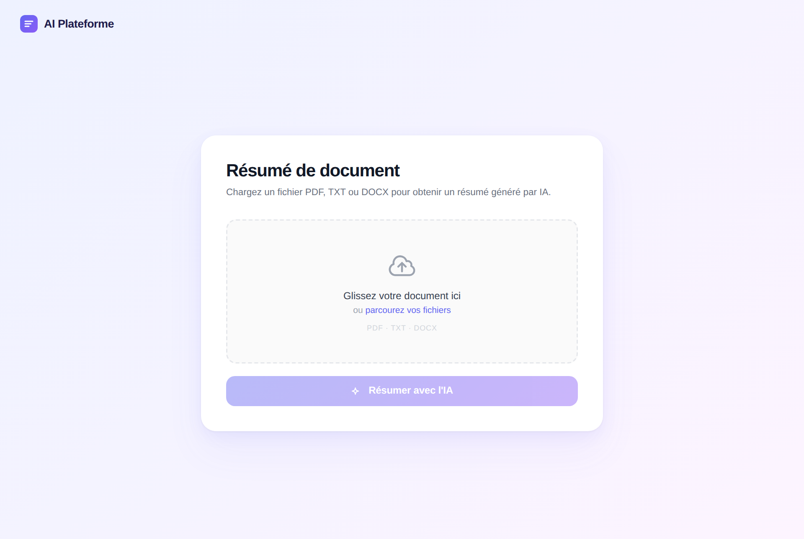
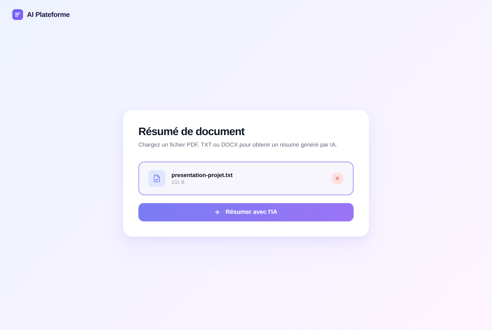
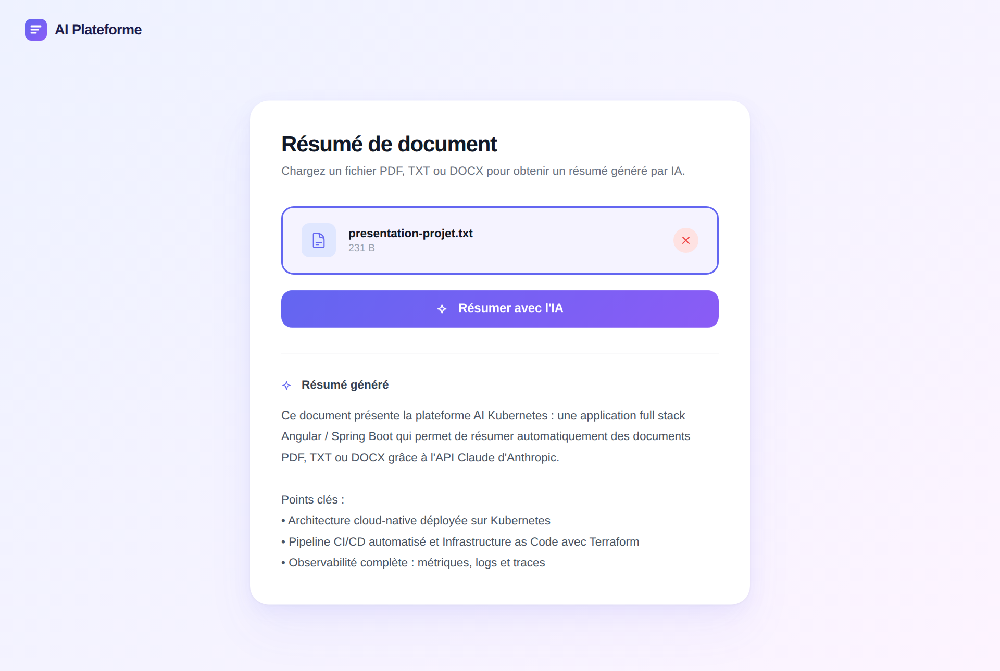
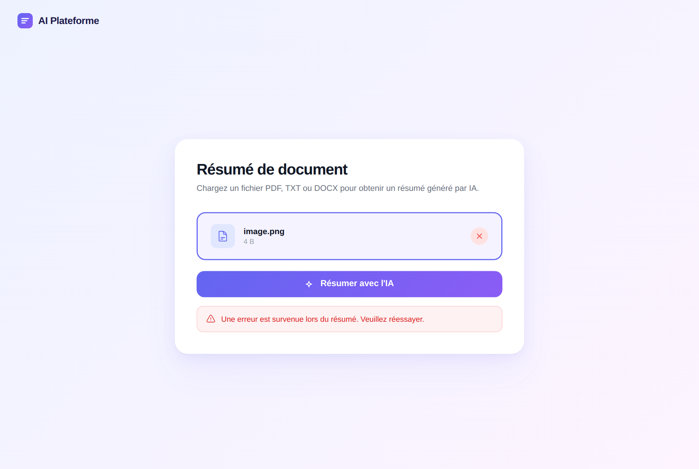

# 🚀 AI Kubernetes Platform

Application Full Stack **Angular / Spring Boot** intégrant l'API **Claude (Anthropic)**, conçue pour être déployée sur Kubernetes avec CI/CD, monitoring et Infrastructure as Code (Terraform).

> Projet vitrine orienté DevOps, Cloud, Full Stack et IA.

---

## 📸 Aperçu

### Écran d'accueil
Glissez-déposez ou sélectionnez un document **PDF, TXT ou DOCX** (10 MB max).



### Fichier sélectionné
Le nom et la taille du fichier s'affichent, le bouton **Résumer avec l'IA** devient actif.



### Résumé généré
Le backend extrait le texte du document, l'envoie à Claude et affiche le résumé en français.



### Gestion des erreurs
Un format non supporté (ici un `.png`) est refusé par l'API et un message d'erreur s'affiche.



---

## 🏗️ Architecture

```
┌──────────────────────┐   /api/*   ┌────────────────────────┐  HTTPS  ┌──────────────────┐
│  Angular 21 (4200)   │ ─────────▶ │  Spring Boot 4 (8080)  │ ──────▶ │  API Anthropic   │
│  ai-plateform-ui     │   proxy    │  ai-plateform-api      │ OpenFeign│  /v1/messages    │
└──────────────────────┘            └───────────┬────────────┘         └──────────────────┘
                                                │ JPA / Flyway
                                                ▼
                                       ┌──────────────────┐
                                       │  PostgreSQL 5432 │
                                       └──────────────────┘
```

| Couche     | Technologies                                                         |
|------------|----------------------------------------------------------------------|
| Frontend   | Angular 21 (standalone, signals, SSR), Vitest                        |
| Backend    | Java 17+, Spring Boot 4, OpenFeign, PDFBox, Apache POI, Flyway       |
| Données    | PostgreSQL                                                           |
| IA         | API Claude (Anthropic) – modèle configurable via `anthropic.model`   |

```
apps/
├── backend/ai-plateform-api     # API REST Spring Boot
└── frontend/ai-plateform-ui     # Application Angular
docs/screenshots                 # Captures utilisées dans ce README
```

---

## ✅ Prérequis

- **Java 17+** (le wrapper Maven `./mvnw` est fourni)
- **Node.js 20+** et npm
- **PostgreSQL** en local avec une base `ai_plateform_db`
- Une **clé API Anthropic** ([console.anthropic.com](https://console.anthropic.com))

Créer la base si elle n'existe pas :

```bash
psql -h localhost -U postgres -c "CREATE DATABASE ai_plateform_db;"
```

Les identifiants de la base en dev sont dans `apps/backend/ai-plateform-api/src/main/resources/application-dev.properties`.

---

## ▶️ Lancer l'application en local

### 1. Backend (port 8080)

Ne commitez jamais votre clé : passez-la par variable d'environnement. Spring la lie automatiquement à `anthropic.api.key`.

```bash
export ANTHROPIC_API_KEY=sk-ant-...
cd apps/backend/ai-plateform-api
./mvnw spring-boot:run          # profil "dev" actif par défaut
```

### 2. Frontend (port 4200)

```bash
cd apps/frontend/ai-plateform-ui
npm install
npm start
```

Ouvrez **http://localhost:4200**. Les appels `/api/*` sont redirigés vers `http://localhost:8080` par le proxy de dev (`proxy.conf.json`).

> 💡 Dans IntelliJ IDEA, la configuration **Start All [dev]** lance le backend et le frontend en même temps.

---

## 🧪 Tester l'application

### Tests automatisés

**Backend** (JUnit 5, Mockito, AssertJ) :

```bash
cd apps/backend/ai-plateform-api
./mvnw test
```

| Test                          | Ce qui est vérifié                                                                 |
|-------------------------------|------------------------------------------------------------------------------------|
| `TextExtractorServiceTest`    | extraction TXT, fichier vide, format non supporté, contenu blanc, troncature à 100 000 caractères |
| `DocumentServiceTest`         | appel à l'API IA (client mocké), extraction du résumé, réponse sans texte          |
| `AiPlateformApiApplicationTests` | démarrage du contexte Spring (⚠️ nécessite PostgreSQL)                          |

**Frontend** (Vitest) :

```bash
cd apps/frontend/ai-plateform-ui
npx ng test --watch=false
```

| Test                          | Ce qui est vérifié                                                    |
|-------------------------------|-----------------------------------------------------------------------|
| `summarizer.component.spec`   | bouton désactivé sans fichier, affichage du résumé, affichage d'erreur, format de taille |
| `app.spec`                    | création de l'application et présence du `router-outlet`              |

### Test manuel de l'API avec curl

```bash
curl -F "file=@mon-document.pdf" http://localhost:8080/api/documents/summarize
```

Réponse :

```json
{ "summary": "Ce document présente ..." }
```

| Cas                             | Code HTTP | Message                                                  |
|---------------------------------|-----------|----------------------------------------------------------|
| Succès                          | `200`     | `{ "summary": "..." }`                                   |
| Fichier vide ou illisible       | `400`     | `Le fichier est vide.` / `Le document est vide ou illisible.` |
| Format non supporté             | `400`     | `Format non supporté. Utilisez PDF, TXT ou DOCX.`        |
| Fichier > 10 MB                 | `413`     | `Le fichier dépasse la taille maximale autorisée (10 MB).` |
| API IA indisponible / clé invalide | `502`  | `L'API IA est indisponible. Veuillez réessayer plus tard.` |

### Tester sans clé API (faux serveur Anthropic)

L'URL de l'API est configurable (`anthropic.api.url`), donc on peut brancher le backend sur un faux serveur local qui renvoie une réponse fixe. C'est pratique pour tester l'interface sans consommer de crédits.

```bash
# 1. Faux serveur sur le port 9090 (renvoie toujours le même résumé)
python3 - <<'EOF'
import json
from http.server import BaseHTTPRequestHandler, HTTPServer
class H(BaseHTTPRequestHandler):
    def do_POST(self):
        self.rfile.read(int(self.headers.get("content-length", 0)))
        body = json.dumps({"id": "mock", "model": "mock", "stop_reason": "end_turn",
                           "content": [{"type": "text", "text": "Résumé de test."}]}).encode()
        self.send_response(200); self.send_header("content-type", "application/json"); self.end_headers()
        self.wfile.write(body)
HTTPServer(("127.0.0.1", 9090), H).serve_forever()
EOF

# 2. Backend branché sur ce faux serveur
cd apps/backend/ai-plateform-api
./mvnw spring-boot:run -Dspring-boot.run.arguments="--anthropic.api.url=http://localhost:9090 --anthropic.api.key=mock"
```

> Les captures de ce README ont été réalisées avec ce faux serveur : le texte du résumé affiché est une réponse simulée.

---

## ⚙️ Configuration

| Propriété              | Défaut                       | Description                    |
|------------------------|------------------------------|--------------------------------|
| `anthropic.api.key`    | –                            | Clé API (`ANTHROPIC_API_KEY`)  |
| `anthropic.api.url`    | `https://api.anthropic.com`  | URL de l'API                   |
| `anthropic.model`      | `claude-sonnet-4-6`          | Modèle Claude utilisé          |
| `spring.servlet.multipart.max-file-size` | `10MB`     | Taille maximale d'un fichier   |

En profil **prod**, la base de données est configurée via `DB_URL`, `DB_USERNAME` et `DB_PASSWORD`.
